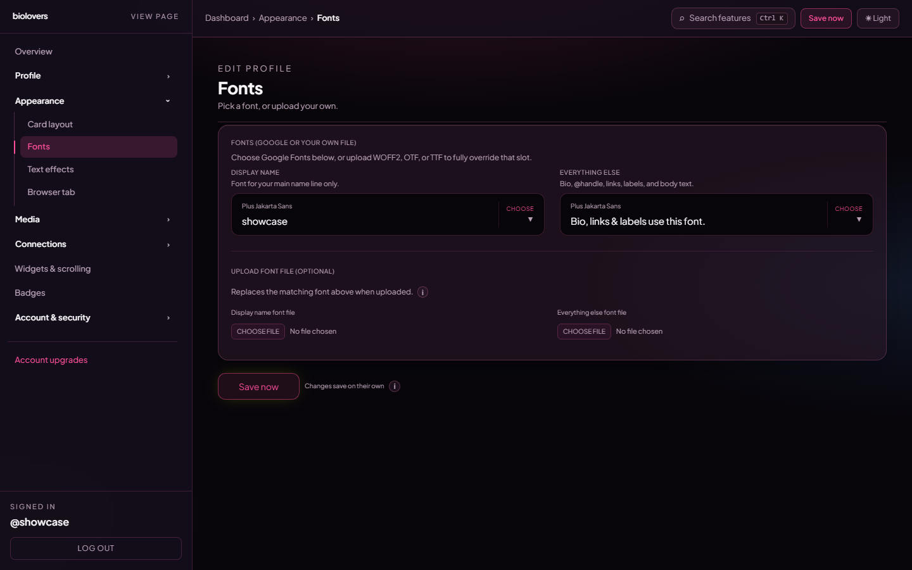

<Note>
Page on the dashboard: <a href="https://dashboard.biolovers.site/dashboard/edit/look/fonts" target="_blank" rel="noopener">dashboard.biolovers.site/dashboard/edit/look/fonts</a>
</Note>

The entire **Fonts** panel is available on Free and Premium — Google Fonts pickers and custom file uploads.

Two font slots:

- **Display name** — font for your main name line only.
- **Everything else** — bio, @handle, links, labels, body text.

<Frame caption="Fonts panel.">
  
</Frame>

## Pick a Google Font

Each slot has a searchable picker — type to filter, click to apply. The preview line right below shows your display name (or `Bio, links & labels use this font.` for the body slot) in the chosen font.

Common picks:

- **Inter / Plus Jakarta Sans** — clean, modern UI feel.
- **Space Grotesk / DM Sans** — geometric, slightly designy.
- **Playfair Display / Cormorant** — serif, editorial.
- **JetBrains Mono / Geist Mono** — monospace, dev/aesthetic.

## Upload a font file

The bottom half of the panel — **Upload font file (optional)** — lets you replace the matching Google Font with your own file.

| Setting | Value |
|---------|-------|
| Formats | **WOFF2** (recommended), **OTF**, **TTF** |
| Max size | **2 MB** per file |
| Upload slots | "Display name font file" and "Everything else font file" |

When you upload a file it overrides whatever Google Font you picked above. To revert, tap **Remove uploaded display name font** / **Remove uploaded everything else font** under the upload slot.

We don't claim any rights to your file and we don't redistribute it — it's served only on your profile page. Use fonts you have a license for.

## Per-widget custom font

The **Markdown infobox widget** has its own font upload that overrides only that widget. See [Markdown infobox](/widgets/markdown-infobox).

## Common questions

<AccordionGroup>
  <Accordion title="Why doesn't my font show up?">
    Double-check the file is one of WOFF2 / OTF / TTF and under 2 MB. Hit refresh on your public page after uploading — the browser may have cached the old font.
  </Accordion>
  <Accordion title="Where do you host the font?">
    Uploaded fonts go to our private storage and are served from your profile page only. Catalog fonts come straight from Google Fonts.
  </Accordion>
  <Accordion title="Is this a Premium feature?">
    No. Google picks and custom uploads (including per-infobox fonts) work on Free. See [What Premium unlocks](/premium/what-premium-unlocks) for what Premium actually gates.
  </Accordion>
</AccordionGroup>
