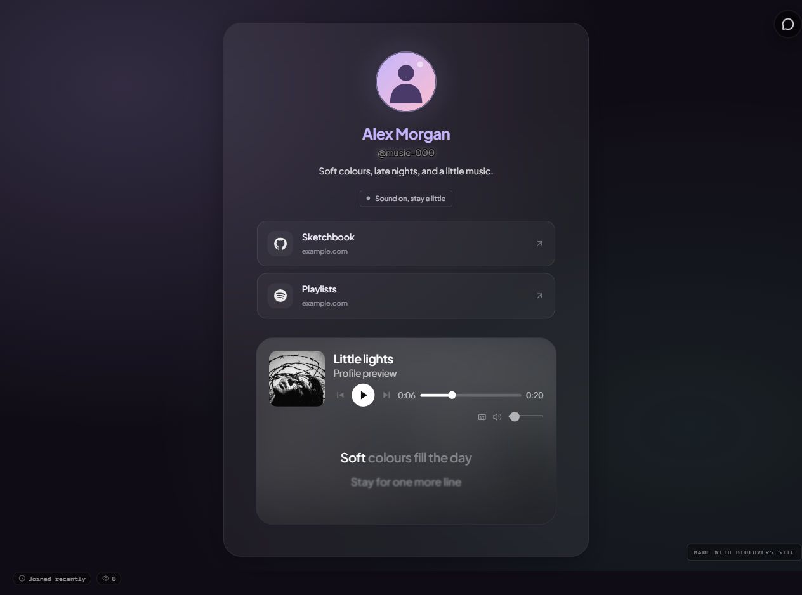

Open [Style → Profile style](https://dashboard.biolovers.site/dashboard/edit/look/card-layout) and find **Profile design**. Header, avatar, link, and backdrop choices are free. **Status** requires [Premium](/premium/what-premium-unlocks).

<Frame caption="An example profile with a centered header, large avatar, link cards, ambient backdrop, and music inside the frame. The personal status and lyrics use Premium.">
  
</Frame>

## Header and avatar

On the [Profile style panel](https://dashboard.biolovers.site/dashboard/edit/look/card-layout), open **Header & avatar**:

| Setting | Choices |
| --- | --- |
| **Header** | **Classic** puts your photo beside your name. **Centered** puts it above your name and centers your introduction. |
| **Avatar size** | **Default** or **Large**. |
| **Avatar frame** | **None**, **Accent ring**, or **Soft halo**. |

Your existing avatar shape and Discord decoration still work with these choices. Change the picture itself in [Music & images → Profile photo](https://dashboard.biolovers.site/dashboard/edit/media/avatar).

Header arrangement is separate from [card width and spacing](/appearance/card-layout). Use **Centered** for the arrangement and **Card width** to control how much room the whole card gets.

## Link cards and spotlight

1. Add and save your links in [Links & accounts → Your links](https://dashboard.biolovers.site/dashboard/edit/connect/socials).
2. Return to [Style → Profile style](https://dashboard.biolovers.site/dashboard/edit/look/card-layout) and open **Links**.
3. Choose **Link cards** for larger rows with a name, destination, and arrow. Choose **Current layout** to keep your existing chips or buttons.
4. Select a **Spotlight link** to feature one saved link above the others. Select **None** to clear it.

The featured link appears once. Removing that link also removes its spotlight. Your wallet buttons and live integration cards keep their own layouts.

## Personal status (Premium)

Open **Status** on the [Profile style panel](https://dashboard.biolovers.site/dashboard/edit/look/card-layout) for a short message such as “Open for commissions” or “Working on something new.”

- Enter up to **80 characters**. Leave the message empty to hide it.
- Choose **Neutral**, **Available**, or **Busy** for its color.
- Pick **Text** for a simple line, **Pill** for a soft fill, or **Tag** for a fine outline.

This is a message you write yourself. Configure live Discord presence separately in [Discord & Telegram](/connections/discord-telegram).

## Ambient backdrops

Open **Backdrop** in [Style → Profile style](https://dashboard.biolovers.site/dashboard/edit/look/card-layout):

| Option | Look |
| --- | --- |
| **None** | Keep your existing background. |
| **Aurora** | Soft cool light. |
| **Dusk** | Warm evening tones. |
| **Mesh** | Blended pools of color. |
| **Grid** | Subtle geometric lines. |

These backdrops stay behind the page as visitors scroll. They are still designs, so reduced-motion settings do not remove them. For a photo or video, use [Music & images → Background](https://dashboard.biolovers.site/dashboard/edit/media/background).

## Start with a look

Open [Templates](https://dashboard.biolovers.site/dashboard/edit/templates) to try **Aurora**, **Studio**, or **Dusk**, alongside **Clean**, **Glass**, and **Arcade**. Each preview shows example content; applying a starter changes the appearance while keeping your own content.

Review the confirmation before applying. Use **Undo** to return to the previous look. See [Profile templates](/templates/profile-templates) for saved looks and full restores.
