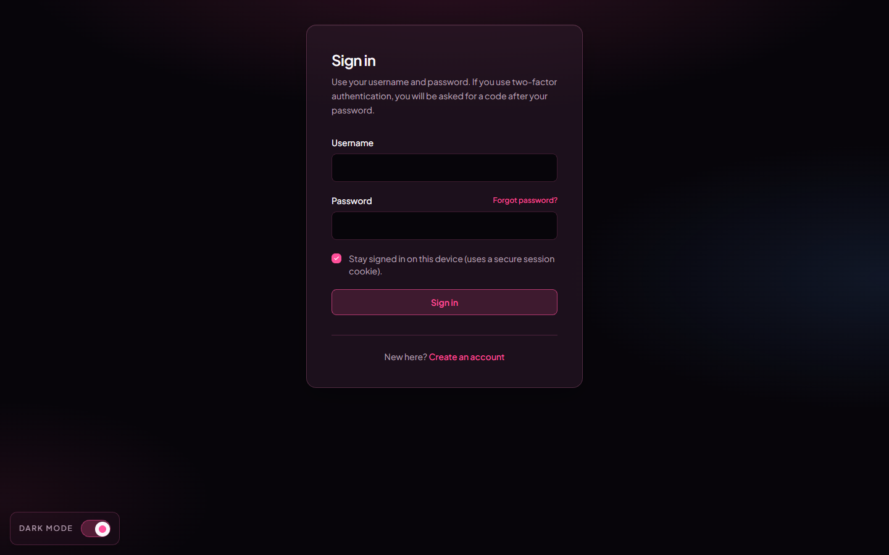

<Note>
Page on the dashboard: <a href="https://dashboard.biolovers.site/login" target="_blank" rel="noopener">dashboard.biolovers.site/login</a>
</Note>

<Frame caption="Login form on the dashboard.">
  
</Frame>

## What you fill in

| Field | What it does |
|-------|--------------|
| **Username** | The username you signed up with. Not case-sensitive. |
| **Password** | Whatever you set at signup or last changed it to. |
| **Authenticator code** *(only shown if you have 2FA on)* | The current 6-digit code from your authenticator app. |

Tap **Sign in**. You land on the dashboard's edit page (`/edit`).

## Sign in with Discord or Google

Below the form there are two buttons — **Continue with Discord** and **Continue with Google**. One click is all it takes:

- If you've signed in with that provider here before, you go straight to your dashboard.
- With Google, if the Google email matches an account you already have, it links Google to that account and signs you in.
- If there's no match, it makes you a brand-new account on the spot — see [Make an account](/getting-started/sign-up).

Discord matches you by your **Discord account**; Google matches by your **Google account**. Either way the email from the provider is filled in for you and already counts as **verified**, so there's nothing to add or confirm afterwards.

<Note>
You don't need a password to use these. They're the same buttons on the sign-up page, so one tap either logs you in or creates the account.
</Note>

## I forgot my password

Two paths back in:

1. **Email reset** — works if you added and verified an email. See [Forgot password](/getting-started/forgot-password). We email you a one-time link that expires in 30 minutes.
2. **Reach out to us** — if you never added an email, see [No email and forgot password](/troubleshooting/no-email-no-password). You'll need to prove the account is yours.

There is **no recovery phrase / 12-word backup** on Biolovers. The only self-serve reset is email.

## I lost my 2FA device

See [I lost my 2FA](/troubleshooting/lost-2fa).

## Why am I getting "too many requests"?

To stop bots from guessing passwords, the dashboard rate-limits sign-in attempts per IP address (24 requests per minute on `/api/auth/*`). If you triggered it, wait about a minute and try again. The same limit applies to forgot-password and 2FA submissions.

## Common questions

<AccordionGroup>
  <Accordion title="Why does it open dashboard.biolovers.site instead of biolovers.site?">
    Editing happens on a separate **dashboard** subdomain. The main site (`biolovers.site`) is for visitors and the marketing pages. The "Login" link in the top-right of the main site sends you to the dashboard automatically.
  </Accordion>
  <Accordion title="Can I stay logged in?">
    Yes. The session cookie lasts about 90 days by default. If you tap **Log out** in the dashboard sidebar or clear your cookies, you'll have to sign in again.
  </Accordion>
  <Accordion title="My password is right but it says wrong?">
    Watch out for accidental spaces, Caps Lock, and your phone autocorrect adding a period. If it really is wrong, use [Forgot password](/getting-started/forgot-password).
  </Accordion>
</AccordionGroup>
