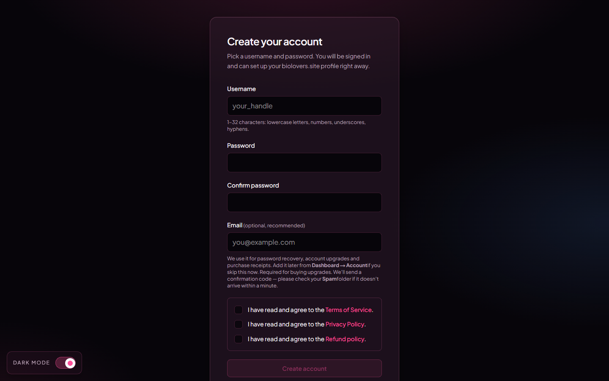

<Note>
Page on the dashboard: <a href="https://dashboard.biolovers.site/register" target="_blank" rel="noopener">dashboard.biolovers.site/register</a>
</Note>

<Frame caption="Sign-up form on the dashboard.">
  
</Frame>

## Fastest way: Discord or Google

Below the form there are two buttons — **Continue with Discord** and **Continue with Google**. One click creates your account: no username to pick, no password to set. We use your provider profile to set things up and sign you in.

The best part is the email — your **verified email from Discord or Google is filled in automatically**, and it counts as verified right away. That means you can buy upgrades or reset a password later without the manual add-and-verify step a typed signup needs.

- **Continue with Discord** — matched to your Discord account. If you don't have an account here yet, one is created from your Discord profile.
- **Continue with Google** — matched to your Google account. If the verified Google email already belongs to an account here, Google is linked to that account and you're signed in; otherwise a new account is created.

The same two buttons are on the [Log in](/getting-started/log-in) page, so you use them whether you're new or coming back.

### Choose your username

Because a Discord or Google signup doesn't ask you to type a username, we start you off with one based on your provider name. The first time you open the dashboard, a **Choose your username** prompt appears:

- Keep the suggested handle, or type your own (1–32 characters: letters, numbers, underscores, hyphens).
- This first pick is **free** and doesn't use the Premium one-rename allowance.

Your public page is live the whole time — the prompt just lets you set the handle you actually want before sharing it. You can still rename later from the [Username panel](/account/username) (Premium).

## What you fill in

| Field | What it does |
|-------|--------------|
| **Username** | Your public page URL becomes `biolovers.site/<username>`. 1–32 characters: letters (any case), numbers, underscores, or hyphens. You can rename later (Premium gets one rename — see [Username](/account/username)). |
| **Password** | At least 8 characters. We hash it before saving — we never see the original. |
| **Confirm password** | Has to match the field above. |
| **Email** *(optional, recommended)* | If you add one, we send a 6-digit code to confirm it. Used for password resets and purchase receipts. You can add or change it any time from the dashboard. **Required to buy any upgrade.** |
| **Terms / Privacy / Refund** | Three checkboxes you have to tick before the button works. |

The submit button reads **Create account** if you skipped email, or **Send verification code** if you added one. With an email, you'll then see a "Confirm your email" step asking for the 6-digit code from your inbox.

<Tip>
You **don't have to** add an email at sign-up. But if you ever forget your password and have no email on file, the only path back in is reaching out to us via [Discord](https://biolovers.site/discord) or the [contact form](https://biolovers.site/contact) and proving the account is yours — see [No email and forgot password](/troubleshooting/no-email-no-password). Adding the email later is one click in [Email](/account/email).
</Tip>

## After you sign up

You land on the **dashboard** (the `/edit` page). From there:

1. Open [Profile → Domain & URL](/profile/domain-and-url) to confirm your username.
2. Open [Profile → Name & about me](/profile/name-and-about) to set your display name and bio.
3. Open [Music & images → Profile photo](/media/avatar) to upload a profile picture.
4. Open `biolovers.site/<your-username>` in a new tab to **preview your page**.

## Common questions

<AccordionGroup>
  <Accordion title="Is sign-up free?">
    Yes. The free tier covers everything except the Premium-only extras listed in [what Premium unlocks](/premium/what-premium-unlocks). No credit card needed at signup.
  </Accordion>
  <Accordion title="Can I change my username later?">
    Premium accounts get one rename from the [Username panel](/account/username). Capitalisation tweaks (e.g. `yuno` → `Yuno`) are unlimited and don't count as the rename. Old links to the old username won't redirect, so tell people the new one.
  </Accordion>
  <Accordion title="What if my username is already taken?">
    The form will tell you and refuse to submit. Pick another, or add numbers / underscores / hyphens. You can also set an **alias slug** later (a second URL that points at the same page — Premium feature).
  </Accordion>
  <Accordion title="My email never came">
    Check **Spam / Promotions** first — codes can land there. The verify step has a **Resend code** button. Codes expire after 15 minutes; if it's still missing after a resend, double-check the address you typed.
  </Accordion>
</AccordionGroup>

## Next

<CardGroup cols={2}>
  <Card title="Log in" icon="key" href="/getting-started/log-in">
    Sign back in next time.
  </Card>
  <Card title="Forgot password" icon="rotate" href="/getting-started/forgot-password">
    Reset by email if you've added one.
  </Card>
</CardGroup>
