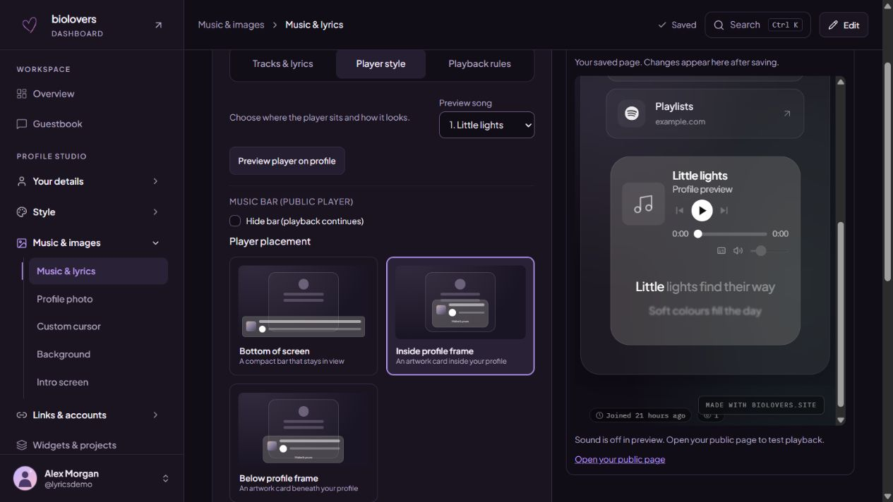
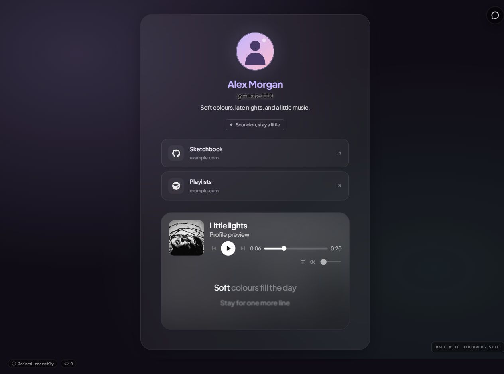
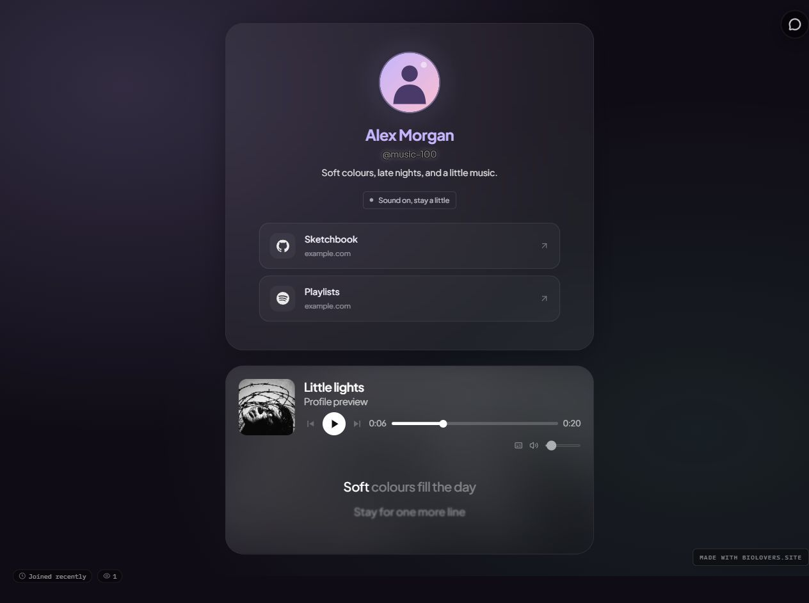
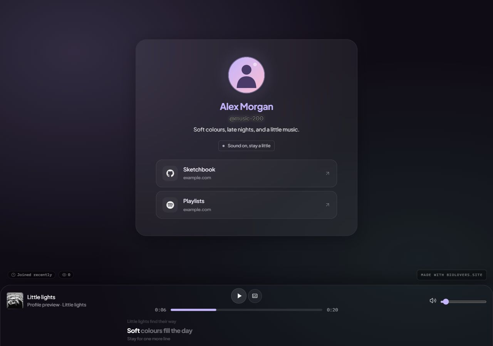

Open [Music & images → Music & lyrics](https://dashboard.biolovers.site/dashboard/edit/media/audio) to add songs and choose how the player looks. Free accounts can use **one track**; Premium can use **up to five**.

| Music tab | What to change |
| --- | --- |
| **Tracks & lyrics** | Uploaded songs, artwork, lyrics, and each track's starting point. |
| **Player style** | Placement, player surface, blur, and the player preview. |
| **Playback rules** | Premium shuffle and country-based starting tracks. |

## Add and edit a track

1. Open **Tracks & lyrics** in the [Music panel](https://dashboard.biolovers.site/dashboard/edit/media/audio).
2. Pick a file: **MP3, OGG, WAV, M4A, or MP4 audio**, up to **20 MiB**. FLAC is not supported.
3. Expand the track's settings. Check or edit its song name, artist, and album.
4. Use **Add album cover** or **Change cover** to choose artwork. Use **Remove cover** to clear it.
5. Open your saved preview to check the result.

The player uses the file's tags when available. Clear an editable tag if you want to hide it.

## Preview the player

In [Music & lyrics](https://dashboard.biolovers.site/dashboard/edit/media/audio), choose **Preview player on profile** to open the saved profile at the player. The preview starts at **Phone** width, **390 px**, and shows your actual player placement, artwork, and lyric style. It stays updated after changes save. On wide desktop windows, the editor remains beside the preview.

Playback controls are disabled there: **Sound is off in preview. Open your public page to test playback.** Use the public page to check audio, seeking, and synchronized lyrics.

Opening a track's details selects that song for preview. You can also use **Preview song** under **Player style** to inspect another track's artwork and lyrics. This only changes the preview; it does not reorder your playlist or change the song visitors hear first.

<Frame caption="Player style keeps your placement choices beside the saved profile preview on desktop.">
  
</Frame>

## Player placement

Open **Player style** on the [Music panel](https://dashboard.biolovers.site/dashboard/edit/media/audio), then choose **Player placement**:

| Placement | Appearance |
| --- | --- |
| **Bottom of screen** | A compact bar pinned to the visitor's screen. This is the default. |
| **Inside profile frame** | A larger music card inside your profile, with artwork, song details, and controls. |
| **Below profile frame** | The same artwork card beneath your profile with a small gap. |

These placements are available on Free and Premium. When [lyrics](/media/lyrics) are enabled on Premium, they appear below the controls. Hiding lyrics also removes their extra space.

<Tabs>
  <Tab title="Inside profile frame">
    <Frame caption="Example profile with an artwork music card inside the profile frame and Glass lyrics below its controls.">
      
    </Frame>
  </Tab>
  <Tab title="Below profile frame">
    <Frame caption="The artwork card beneath the profile frame.">
      
    </Frame>
  </Tab>
  <Tab title="Bottom of screen">
    <Frame caption="The compact bottom bar with lyrics beneath its song controls.">
      
    </Frame>
  </Tab>
</Tabs>

**Hide bar (playback continues)** hides the player. Visitors' remembered pause or mute choices, or blocked playback, can expose controls so they can restore sound.

## Player surface

In **Player style**, choose **Site default**, **Solid**, **Glass**, or **Transparent** under **Music bar panel**. Site default matches the profile card; an explicit choice gives the music player its own surface.

These surface choices are free. **Custom backdrop blur**, from **0 to 50 px**, requires Premium. The separate **Transparent card panel** in [Layout](/appearance/card-layout) is also Premium.

## Lyrics (Premium)

Each uploaded track has its own **Show lyrics** switch, **Upload .lrc** button, style picker, and timing adjustment when timed lyrics are available. Use embedded lyrics or import a matching timed LRC without uploading the audio again.

See [Lyrics and LRC files](/media/lyrics) for **Glass / Karaoke / Minimal**, where to find LRC files, line-versus-word timing, and fixing early or late text.

## Playlist order and starting point

In **Tracks & lyrics** on the [Music panel](https://dashboard.biolovers.site/dashboard/edit/media/audio):

- Use the **↑ / ↓** buttons on each track row to reorder it. Use **Remove** to delete it.
- Set **Start at** to seconds or mm:ss, such as **45** or **0:30**, to skip an intro. Leave it empty to start from the beginning.

In **Playback rules**:

- With two or more Premium tracks, turn on **Shuffle tracks (random first track and order)** to shuffle the starting song and queue.
- Use **Add country rule** to choose a starting track for a country. A country rule takes priority; other visitors use shuffle or the first track.

## Sound from a background video

After uploading a video in [Music & images → Background](https://dashboard.biolovers.site/dashboard/edit/media/background), enable **Use music from background video** on the [Music panel](https://dashboard.biolovers.site/dashboard/edit/media/audio).

The player controls that video's audio instead of uploaded songs. The video needs an audio track. Uploaded songs stay saved and resume when you turn this option off. Lyrics from uploaded tracks are not shown in this mode.

## Playback and visitor preferences

Browsers can require a tap before music plays. A [splash screen](/media/splash) provides that interaction. Visitors can pause, mute, or change the volume; those choices are remembered in their browser. A remembered pause or mute should be checked before treating silence as a problem.

See [Audio player](/public-profile/audio-player) for visitor controls and [Audio won't autoplay](/troubleshooting/audio-autoplay) if playback is blocked.
