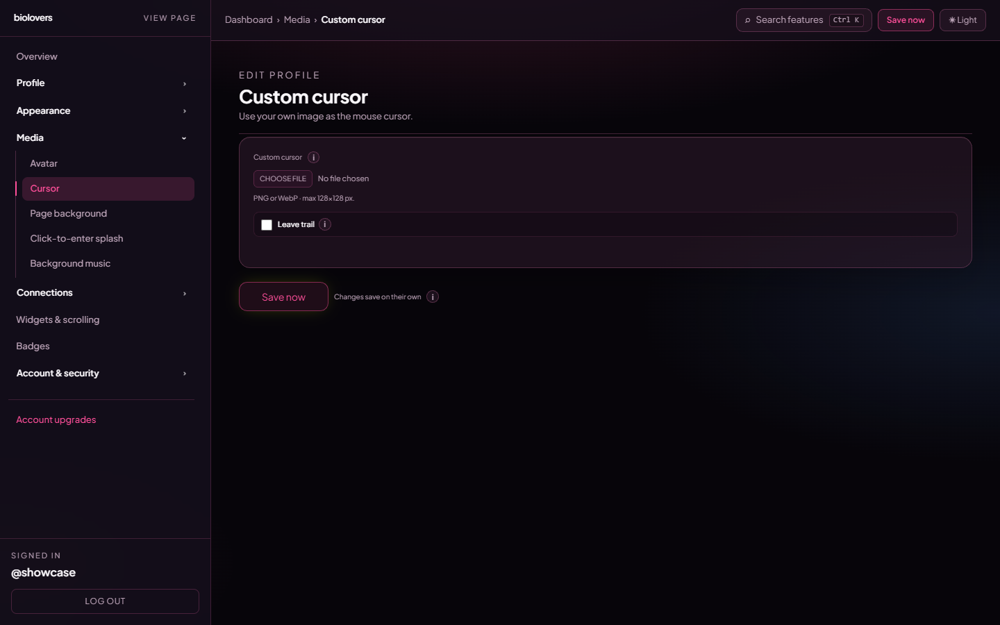

<Note>
Page on the dashboard: <a href="https://dashboard.biolovers.site/dashboard/edit/media/cursor" target="_blank" rel="noopener">dashboard.biolovers.site/dashboard/edit/media/cursor</a>
</Note>

Replaces the mouse arrow on your **public page** with an image of your choice. Doesn't change anything in the dashboard.

<Frame caption="Custom cursor panel.">
  
</Frame>

## Upload

- Pick a file in the upload slot.
- Formats: **PNG, WebP, or GIF** — including animated GIF, APNG, and animated WebP.
- **Static cursors max 128 × 128 pixels.** Anything bigger is rejected — browsers refuse to render large static cursor images for performance reasons.
- **Animated cursors are not bound by the 128 × 128 limit** (see below) — but keep them small (24–64 px looks best) so they don't cover what you're clicking.
- **Max file size: 512 KB.**
- Transparent backgrounds work great — use a PNG or WebP with alpha.

## Animated cursors

Upload an **animated GIF, APNG, or animated WebP** and it plays as your cursor follows the mouse on your public page.

How it works: the browser's normal cursor can only show a single still frame, so for animated files we hide the system arrow and draw your animation right where the pointer is. A few things to know:

- It's **desktop-only** — phones and tablets have no pointer to follow.
- The animation is **clamped on screen** (up to roughly 96 px wide) so an oversized file still behaves.
- Because animated cursors skip the native cursor entirely, the **128 × 128 limit doesn't apply** to them.
- Static PNG / WebP cursors keep using the normal, lighter browser cursor.

## Hot-spot

The hot-spot is the **point** of the cursor — where the click registers. The system **auto-centers** it: the click point is the middle of your image. There's no UI to pick a custom hot-spot.

## Trail (optional)

A single checkbox: **Leave trail**. When on, the cursor leaves fading copies for 1.2 seconds.

If you haven't uploaded a custom cursor, the trail falls back to a small accent-coloured dot.

That's it — there are no extra knobs for trail length, fade speed, or colour tint. Trim the trail visually by picking a smaller cursor image.

## Remove

Tap **Remove** under the preview to clear the cursor and revert to the system arrow.

## Common questions

<AccordionGroup>
  <Accordion title="My cursor isn't showing">
    For a **static** PNG / WebP, check it's **128 × 128 or smaller** and under **512 KB** — bigger files won't apply because the browser's cursor spec caps the size. For an **animated** GIF / APNG / WebP, the size limit doesn't apply, but it's still desktop-only and capped at **512 KB**.
  </Accordion>
  <Accordion title="Why is my click slightly off?">
    The hot-spot is auto-centered, so design your cursor with the click point in the middle of the canvas. There's no per-pixel hot-spot picker.
  </Accordion>
  <Accordion title="Does the trail work on phones?">
    No — phones don't have a cursor. The trail is desktop-only.
  </Accordion>
  <Accordion title="Can I use an animated cursor?">
    Yes — upload an animated **GIF, APNG, or animated WebP**. It plays while following your mouse on your public page (desktop only). Static PNG / WebP cursors still work as a normal still cursor.
  </Accordion>
  <Accordion title="Can I tune the trail length / speed / colour?">
    Not from the dashboard — the trail is a single on / off toggle with a fixed 1.2-second fade.
  </Accordion>
</AccordionGroup>
