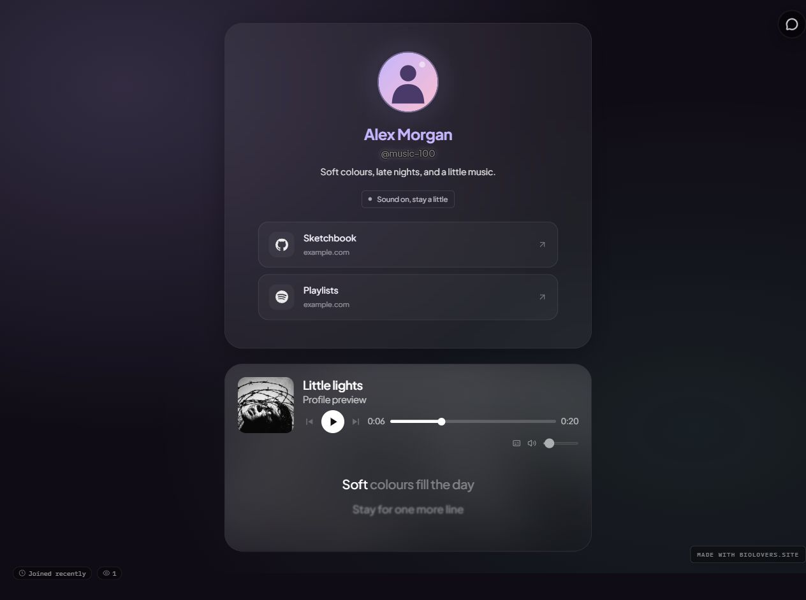

[Premium](/premium/what-premium-unlocks) can show lyrics for uploaded profile tracks. Open [Music & images → Music & lyrics](https://dashboard.biolovers.site/dashboard/edit/media/audio), then **Tracks & lyrics**. Use lyrics already embedded in the audio or attach a separate **.lrc** file.

<Note>
Biolovers does not find or generate lyrics automatically. The audio and its lyrics need to match the same recording: original, live, remix, sped-up, and slowed versions can all have different timing.
</Note>

## Show lyrics

<Steps>
  <Step title="Upload your track">
    Add an audio file in [Music → Tracks & lyrics](https://dashboard.biolovers.site/dashboard/edit/media/audio). See [Background music](/media/background-music) for formats and file limits.
  </Step>
  <Step title="Add lyric data if needed">
    Expand the track's settings. If the audio already contains usable lyrics, they are available here. Otherwise, click **Upload .lrc** and select a matching timed file from your device. The maximum LRC size is **256 KiB**.
  </Step>
  <Step title="Enable and style">
    Turn on **Show lyrics** and choose **Glass**, **Karaoke**, or **Minimal**. Use **Preview player on profile** to check the saved appearance, then open your public page and play the track to check synchronization.
  </Step>
</Steps>

The same controls are available in the song step of first-run setup. Importing an LRC attaches it to that track and enables lyrics; it does not require another audio upload.

<Note>
The saved preview shows your actual player and lyric style, but its playback controls are disabled. Sound is off in preview. Open your public page to test playback and timing. The preview defaults to Phone width at 390 px and updates after changes save.

For a playlist, open that track's details or choose it in **Player style → Preview song**. The preview then shows that song's lyrics without changing your public playlist order.
</Note>

If **Show lyrics** is disabled and its help says **“Audiofile doesnt include lyric data”**, the track has no usable lyric data yet. Import an LRC or upload a file with embedded lyrics. A file with words but no timestamps can display text, but cannot follow the song.

## Where to get an LRC

| Source | How to use it |
| --- | --- |
| [LRCLIB](https://lrclib.net/) | Search the lyrics database for the correct song, artist, and recording. Look for synced lyrics when available. |
| [LRCGET](https://github.com/tranxuanthang/lrcget) | Use the desktop app to find and save matching .lrc files beside music in your local library. It is a client for LRCLIB. |
| [SpotMP3](https://spotmp3.net/) | When the service offers a separate .lrc download for a track, save it and attach it with **Upload .lrc**. Lyrics are not available for every track. |

SpotMP3's [homepage FAQ](https://spotmp3.net/) says synced lyrics are separate files when available and that its matched audio can differ from the original recording. Listen to the audio and check its duration before choosing the lyrics. Downloading the MP3 alone does not guarantee that lyric data is embedded in it.

These are external services. Their catalogs and download options can change. Biolovers imports a file you have saved; it does not connect to your account on those services.

## Line, word, and plain lyrics

| Available data | What visitors see |
| --- | --- |
| **Line timestamps** | Each line appears at its supplied time. The whole line changes together. |
| **Word or syllable timestamps** | Supplied words or segments highlight as their timestamps are reached. |
| **Plain embedded text** | A readable scrollable lyric panel without synchronization. |

A normal LRC often has only line timestamps. Choosing **Karaoke** does not add word timing. For word highlights, the file must include actual word or segment timestamps, such as enhanced LRC.

## Choose a style

- **Glass** keeps nearby lines softly dimmed on the player's surface.
- **Karaoke** gives the current line more prominence.
- **Minimal** uses quieter text without an additional frame.

Lyrics stay **below the song controls** in every placement. Inside or below the profile frame, the player uses a larger artwork music card. At the bottom of the screen, it keeps the compact bar layout. Visitors can hide and show lyrics with the player's lyrics button.

<Frame caption="Glass lyrics below the controls in an example music card placed beneath the profile frame.">
  
</Frame>

## Fix lyrics that are early or late

For timed lyrics, find **Lyrics timing** in that track's [Music settings](https://dashboard.biolovers.site/dashboard/edit/media/audio):

- **Negative seconds** show lyrics **earlier**. Try **-0.5** if they appear half a second late.
- **Positive seconds** show lyrics **later**. Try **0.5** if they appear half a second early.
- **Reset** returns the adjustment to **0**. The range is **-10 to 10 seconds**.

This changes when the text appears. **Start at** changes where the audio begins; it is a different control.

If the lyrics drift further out of sync as the song plays, a constant adjustment will not fix the whole song. Replace the LRC with one for the same recording and speed.

## Replace or remove an import

Use **Replace .lrc** on the same track to replace the imported lyrics. Use **Remove .lrc** to return to any lyrics embedded in the audio. If none remain, **Show lyrics** turns off.

An imported LRC takes priority over embedded lyrics. Removing a track removes its lyric settings too. Lyrics are not shown when the player uses sound from your background video.

<Tip>
If an older audio upload is being checked, wait for the check to finish. If it fails, use **Retry**. A successful check with no lyrics still needs an LRC or a newly tagged audio file.
</Tip>
