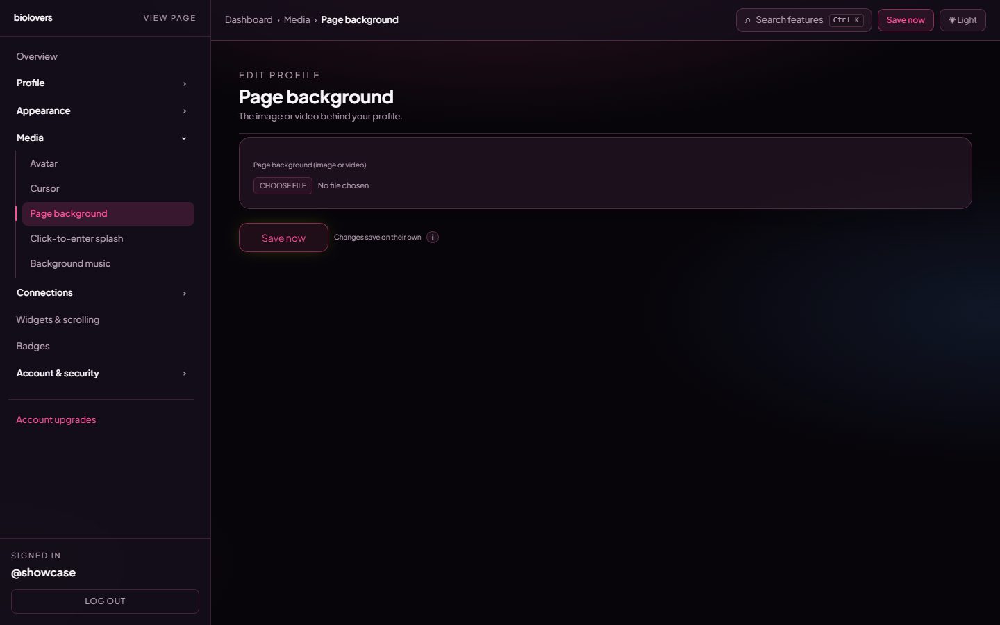

<Note>
Page on the dashboard: <a href="https://dashboard.biolovers.site/dashboard/edit/media/background" target="_blank" rel="noopener">dashboard.biolovers.site/dashboard/edit/media/background</a>
</Note>

The big thing **behind** your profile card. The dashboard panel is intentionally minimal — just an upload slot and a preview.

<Frame caption="Page background panel.">
  
</Frame>

## Ambient color or grid

For a background without another upload, open [Style → Profile style](https://dashboard.biolovers.site/dashboard/edit/look/card-layout), then **Backdrop**. **Aurora**, **Dusk**, **Mesh**, and **Grid** are free and stay behind the page as visitors scroll. Choose **None** to remove the ambient treatment. See [Profile design](/appearance/profile-design#ambient-backdrops).

## Upload

| Type | Formats | Max size |
|------|---------|----------|
| **Image** | JPEG / PNG / WebP / GIF | **10 MiB** |
| **Video** | MP4 / WebM / MOV | **100 MiB** (Free) / **350 MiB** (Premium) |

Pick one file in the file picker. There is no separate "image / video / colour" mode toggle — the file you upload determines the type. Free accounts that upload a video over 100 MiB get an upgrade hint; Premium raises the soft cap to 350 MiB for splash and page-backdrop video only (portfolio clips and images keep their normal limits).

The image / video is auto-fitted to fully cover the screen (cropped if necessary).

## Video specifics

- Plays muted, loops, autoplays.
- Large videos are progressively transcoded to **HLS** for smoother streaming on slow connections; the original file is kept as a fallback.
- iOS only autoplays muted videos in low-power mode — there's nothing to toggle on our end.

## Remove

Tap **Remove** under the preview to clear the background. Your profile falls back to the default page colour from your theme.

## What the panel does **not** have

The panel is purely upload + preview. None of the following live here:

- Solid colour picker (use the [accent color](/profile/name-and-about) if you want a tinted feel — full background colour skinning isn't a separate control).
- Blur / dim / vignette / position / cover sliders.
- Mobile-fallback image — phones load the same file.

If you want a softer look behind text, set the **Card panel** to **Solid** in [Card layout](/appearance/card-layout) so the card itself blocks the busy area.

## Tips

- Heavy videos slow down first paint. If your audience is mostly on phones, prefer a **static image** under 1 MiB.
- For text legibility, switch the **Card panel** to **Solid** or use a [Text effect](/appearance/text-effects) **Outline / Soft shadow** on the bio.

## Common questions

<AccordionGroup>
  <Accordion title="My video looks blurry">
    The HLS transcode auto-picks bitrate based on the visitor's connection. Upload a higher-resolution source if your video looks soft on fast connections.
  </Accordion>
  <Accordion title="Can I have a different background per scroll page?">
    Not yet — backgrounds are per profile. Scroll pages share the same backdrop.
  </Accordion>
  <Accordion title="The background doesn't autoplay on iPhone">
    iOS only autoplays muted videos. We already enforce muted, but Low Power Mode on the visitor's device can still block it — that's a system setting we can't override.
  </Accordion>
  <Accordion title="Can I dim the background to make text readable?">
    Not directly. Use a card panel of **Solid** or apply an outline / soft-shadow text effect for contrast.
  </Accordion>
  <Accordion title="My video is too big to upload">
    Free accounts cap splash / backdrop video at **100 MiB**. Premium raises that to **350 MiB** — see [What Premium unlocks](/premium/what-premium-unlocks). Or re-encode to a smaller bitrate / shorter loop.
  </Accordion>
</AccordionGroup>
