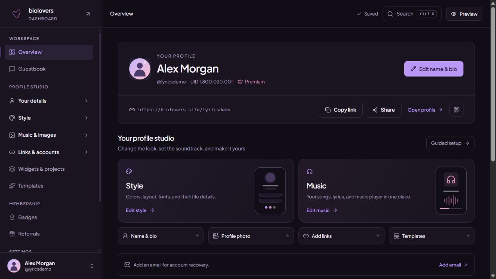

[Overview](https://dashboard.biolovers.site/dashboard/edit) is the starting point for editing and sharing your profile.

## Your profile studio

Choose **Style → Edit style** for the [Profile style panel](https://dashboard.biolovers.site/dashboard/edit/look/card-layout), or **Music → Edit music** for [Music & lyrics](https://dashboard.biolovers.site/dashboard/edit/media/audio). These are the main editing shortcuts above your traffic charts.

<Frame caption="Overview puts Style, Music, and the first setup steps together.">
  
</Frame>

Other shortcuts open **Name & bio**, **Profile photo**, **Add links**, and **Templates**. Use **Guided setup** if you want to work through the first steps in order.

## Find a setting in the sidebar

| Section | What to open |
| --- | --- |
| **Your details** | Your URL, name and bio, location, and stats. |
| **Style** | **Profile style** for headers, avatar frames, links, status, backdrops, and advanced card controls; also fonts, text effects, and the browser tab. |
| **Music & images** | **Music & lyrics** first, followed by your profile photo, custom cursor, background, and intro screen. |
| **Links & accounts** | **Your links**, **Connected cards**, **Discord & Telegram**, and **Tips & wallets**. |
| **Templates** | Free starter looks, saved profiles, and the marketplace. |

Inside **Music & lyrics**, use **Tracks & lyrics**, **Player style**, or **Playback rules**. Inside **Profile style**, use **Header & avatar**, **Links**, **Status**, or **Backdrop**. Open **Card shape & advanced layout** for the older sizing and panel controls.

See [Profile design](/appearance/profile-design), [Background music](/media/background-music), or [Lyrics and LRC files](/media/lyrics) for the full steps.

## Share and preview

Your profile header shows its public URL and these actions:

- **Copy link** copies the URL.
- **Share** opens your device's sharing options where available.
- **Open profile** opens the public page.
- The **QR code** button lets someone scan your link.

Use the dashboard's **Preview** button while editing to inspect the saved profile without adding public view or click activity. It starts in **Phone** view at **390 px**; switch to Desktop to check a wider layout. On wide desktop windows, the editor and preview sit side by side so you can keep editing.

The preview updates after your changes save. It shows the actual music-player layout and selected lyric style with playback controls disabled. **Sound is off in preview. Open your public page to test playback.** Opening the public URL is a normal profile visit.

## Next steps and profile health

The next-step and health cards point to unfinished setup or settings that need attention. For example, add an email for account recovery or review a connected card that could not refresh. Follow the action shown on the card.

## Traffic & insights

Expand **Traffic & insights** to see your charts. It may stay collapsed when your page has little activity.

| Summary | Meaning |
| --- | --- |
| **Lifetime views** | Your profile's all-time view total. |
| **Profile views** | Views in the selected range. |
| **Total clicks** | Click activity in the selected range. |

Choose **24h**, **7d**, **30d**, or **All**, then switch the Traffic chart between **Views**, **Visitors**, and **Clicks**. Hover a point for its value.

Below the chart, review visitor devices, top countries, and your most-clicked links, projects, and connected cards. Looking at a card is different from following its link.

<Note>
These are aggregate stats. They do not show a list of visitors' names. A lifetime total and a chart with a selected date range may differ because they cover different periods.
</Note>

## If a chart looks empty

Try a longer range and check that you have shared the correct public link. Newly created pages can have little activity. Your saved editor preview does not add traffic.

For profile URL help, see [Domain & URL](/profile/domain-and-url). To add places visitors can click, see [Your links](/connections/social-links).
