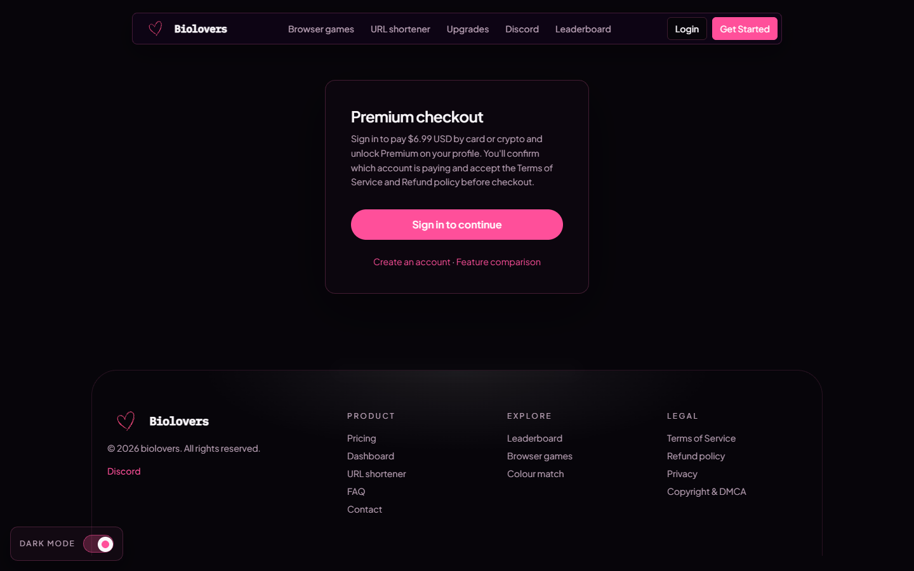

<Note>
Buy: <a href="https://biolovers.site/premium" target="_blank" rel="noopener">biolovers.site/premium</a> — **$6.99 lifetime, one-time payment.** Gift it to someone else at <a href="https://biolovers.site/gift" target="_blank" rel="noopener">biolovers.site/gift</a>.
</Note>

<Frame caption="Premium checkout page.">
  
</Frame>

## Feature matrix

| Feature | Free | Premium |
|---------|------|---------|
| Username + page URL on **biolovers.site** | Yes | Yes |
| Avatar, bio, display name, social link chips | Yes | Yes |
| Live tiles (Spotify, YouTube, GitHub, Steam, Tarkov…) | Yes | Yes |
| Page background (image / video / color) | Yes | Yes |
| Background **video** upload size | **100 MiB** | **350 MiB** |
| Custom cursor (max 128 × 128 px, 512 KB) | Yes | Yes |
| **Fonts** (Google picker + custom uploads, incl. per-infobox) | Yes | Yes |
| Background music | 1 track (max **20 MiB**/file) | **Up to 5 tracks** + smart-start placement |
| **[Click sounds](/media/click-sounds)** (plays when visitors click) | — | **Yes** |
| **[Profile comments](/public-profile/comments)** (chat-bubble guestbook + button placement) | — | **Yes** |
| Profile widgets (16 max) | Yes | Yes |
| Steam inventory widget | Yes | Yes |
| Gaming settings widget | 3 catalog games | **Up to 12 games + custom games + custom logos + stored config files + show all sens** |
| Earned badges + custom badges | Yes | Yes |
| **[Site badge customization](/badges/earned-badges)** (size, universal colour, per-badge colour, reorder) | — | **Yes** |
| Page analytics | Yes | Yes |
| **[Short links (eyz.lol)](/tools/url-shortener)** daily create quota | 10 / day | **100 / day** |
| **First-party domains** (`larp.tax`, `dominated.lol`, `lyrisch.bio`, `vouched.lol`) | — | **Yes** |
| **[Your own domain](/profile/custom-domain)** | — | **Yes** |
| **Page alias** (a second URL slug, 1–32 chars) | — | **Yes** |
| **One username rename** (capitalisation tweaks always free) | — | **Yes** |
| **Remove "Made with biolovers.site" watermark** | — | **Yes** |
| **Hide view count / public user ID** | — | **Yes** |
| **Custom favicon + browser tab title + typewriter** | — | **Yes** |
| **Custom Open-Graph banner (link preview)** | — | **Yes** |
| **Page description + theme color** for SEO / shares | — | **Yes** |
| **Discord premium role** in our server (when linked) | — | **Yes** |
| **Premium auto-refresh on social tiles** (~6 h staggered re-poll on top of the per-tile TTL) | — | **Yes** |
| **Premium badge** next to your name | — | **Yes** |
| **Per-chip icon tint** on social link chips | — | **Yes** |
| **Custom backdrop blur (0–50 px)** on infoboxes & cards | — | **Yes** |
| **Bio typing animation & splash-to-page transition** | — | **Yes** |
| Tarkov live-tile **stash** button | — | **Yes** |
| Visitor analytics (devices, countries, daily charts) | Yes | Yes |
| Two-step sign-in (2FA) | Yes | Yes |

<Tip>
The **custom cursor** panel itself is open to free users (set image, size). The **trail** sub-controls are gated separately — see [Custom cursor](/media/custom-cursor) for the exact gating.
</Tip>

## Common questions

<AccordionGroup>
  <Accordion title="Is Premium really lifetime?">
    Yes. One payment. We never ask for it again. If we ever switch to subscriptions, anyone who already paid lifetime keeps lifetime — see the [Refund policy](https://biolovers.site/refund).
  </Accordion>
  <Accordion title="Can I gift Premium to someone?">
    Yes. Open <a href="https://biolovers.site/gift" target="_blank" rel="noopener">biolovers.site/gift</a>, search their username, and pay with card or crypto. You can also gift custom badge slots. Full guide: [Gift Premium or badge slots](/premium/gift).
  </Accordion>
  <Accordion title="Will I lose Premium if I change my username?">
    No. Premium is tied to your **account**, not your URL. Renaming uses your one allowance — see [Username](/account/username) for the rules. Capitalisation tweaks don't count.
  </Accordion>
  <Accordion title="What happens to my profile if I never buy Premium?">
    Nothing — the free tier stays free forever. You just don't get the Premium-only options listed above. Fonts, cursors, widgets, and a single music track stay available.
  </Accordion>
  <Accordion title="Why does the marketing page say 12 tracks?">
    It doesn't — Premium tops out at **5 audio tracks** (the schema cap). Anywhere you see "12" was a docs typo, now corrected.
  </Accordion>
</AccordionGroup>

## Next

<CardGroup cols={3}>
  <Card title="Pay with card" icon="credit-card" href="/premium/pay-with-card">
    Visa, Mastercard, Apple Pay via Stripe.
  </Card>
  <Card title="Pay with crypto" icon="bitcoin-sign" href="/premium/pay-with-crypto">
    BTC, ETH, USDC, and 100+ coins via NOWPayments.
  </Card>
  <Card title="Gift someone" icon="gift" href="/premium/gift">
    Premium or custom badge slots for another member.
  </Card>
</CardGroup>
