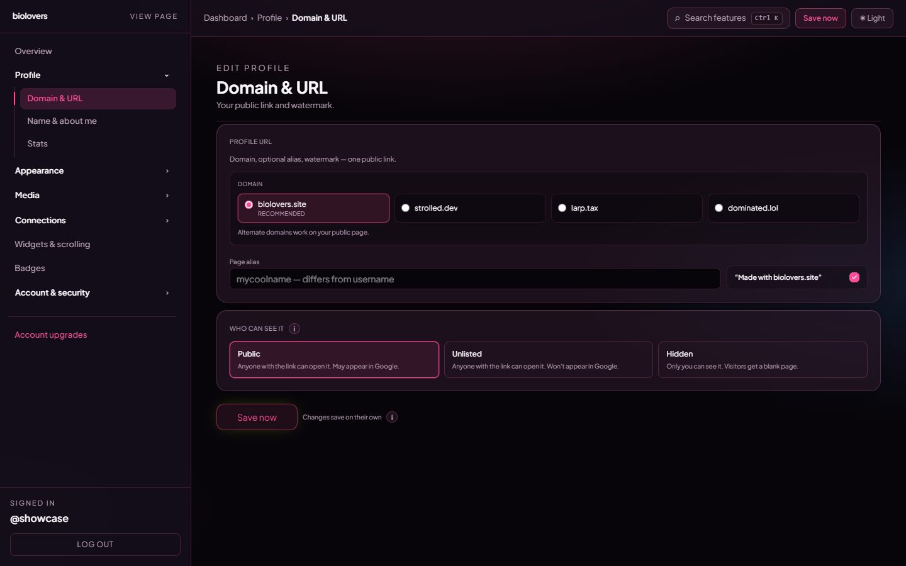

<Note>
Page on the dashboard: <a href="https://dashboard.biolovers.site/dashboard/edit/profile/url" target="_blank" rel="noopener">dashboard.biolovers.site/dashboard/edit/profile/url</a>
</Note>

This is where you set the **link people share to find you** and decide who can open it.

<Frame caption="The Domain & URL panel.">
  
</Frame>

## Domain

Pick which apex shows up in your URL. The default works for everybody.

| Option | Your URL becomes | Notes |
|--------|------------------|-------|
| **biolovers.site** *(recommended)* | `biolovers.site/yourname` | Default. Free. |
| **larp.tax** | `larp.tax/yourname` | **Premium**. Same page, different domain. |
| **dominated.lol** | `dominated.lol/yourname` | **Premium**. |
| **lyrisch.bio** | `lyrisch.bio/yourname` | **Premium**. |
| **vouched.lol** | `vouched.lol/yourname` | **Premium**. |
| **Your own domain** | `yourdomain.com` | **Premium**. See [Use your own domain](/profile/custom-domain). |

`strolled.dev` is no longer offered. If you used it before, switch to **biolovers.site** or another option above; old `strolled.dev/yourname` links still open.

The Premium first-party names all serve the **same profile** — pick whichever vibe matches you. You can switch any time. The previous URL stops working immediately, so tell people the new one.

## Page alias *(Premium)*

A **second slug** for the same profile. If your username is `enderman123` you might set the alias to `ender` so people can use either:

- `biolovers.site/enderman123`
- `biolovers.site/ender`

Rules: 1–32 chars, letters (any case) / numbers / `_` / `-` — same character set as the username. The casing you type is preserved in the URL (e.g. `Ender` stays `Ender`). Leave the field empty for "no alias".

## "Made with biolovers.site" watermark

A small footer line on your public page. Two states:

- **Free:** the watermark is **always on**. The toggle is locked.
- **Premium:** the toggle is yours — turn it off to remove the watermark, or leave it on to support the project.

## Who can see it

Three buttons, three modes:

| Mode | Who can open `/yourname` | Search engines? |
|------|--------------------------|-----------------|
| **Public** | Anyone with the link. | **Yes** — your page may appear in Google. |
| **Unlisted** | Anyone with the link. | **No** — `noindex` sent to search engines. |
| **Hidden** | **Only you** when signed in. Visitors get a placeholder. | No. |

If you set Hidden, an orange banner appears reminding you that visitors will see "Profile hidden" until you switch back.

## Common questions

<AccordionGroup>
  <Accordion title="Can I use my own domain (yourdomain.com)?">
    Yes. Full steps: [Use your own domain](/profile/custom-domain).
  </Accordion>
  <Accordion title="If I change username, do old links redirect?">
    No. Old links 404 the moment you save. If you have Premium, set the **alias slug** to the old name so both work. Full details: [Username](/account/username).
  </Accordion>
  <Accordion title="Is 'Unlisted' actually private?">
    Anyone with the link can still open it. It just keeps Google + Bing from indexing the page. For "only me", pick **Hidden**.
  </Accordion>
  <Accordion title="What's the difference between username and alias?">
    Your **username** is the account login + the default URL. Your **alias** is an extra URL pointing to the same page. You always have a username; the alias is optional.
  </Accordion>
  <Accordion title="My alias keeps stripping characters">
    The form silently removes anything that isn't a letter, digit, `_`, or `-`. Spaces and emoji aren't allowed in URLs. Casing is preserved.
  </Accordion>
</AccordionGroup>

## Related

<CardGroup cols={2}>
  <Card title="Use your own domain" icon="globe" href="/profile/custom-domain">
    Put your page on yourdomain.com.
  </Card>
  <Card title="What Premium unlocks" icon="star" href="/premium/what-premium-unlocks">
    Domains, alias, watermark off, and more.
  </Card>
</CardGroup>
