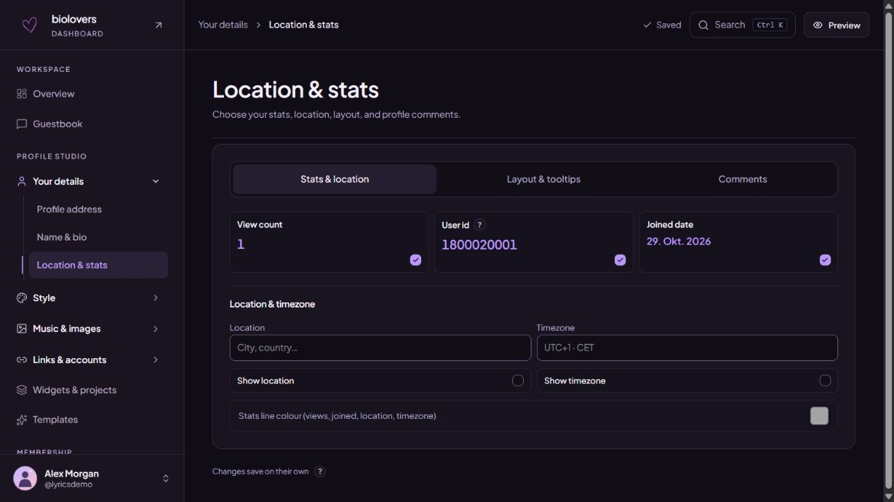
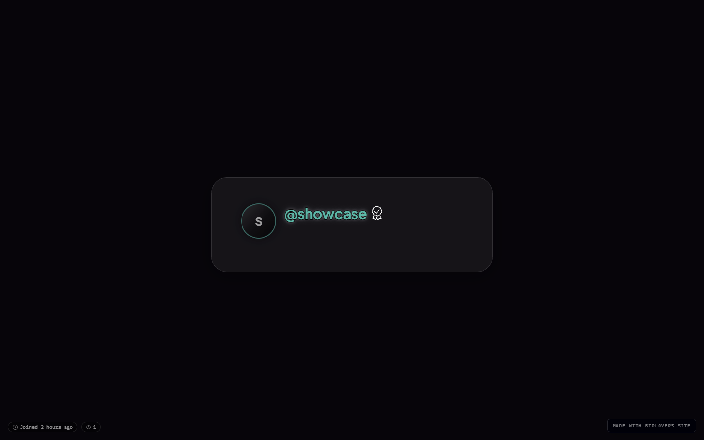
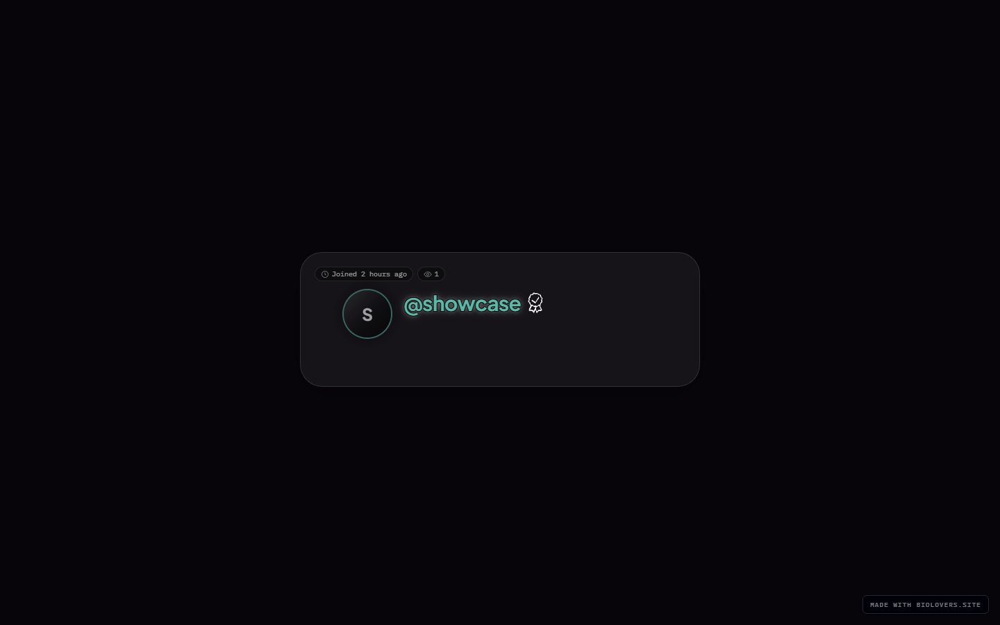
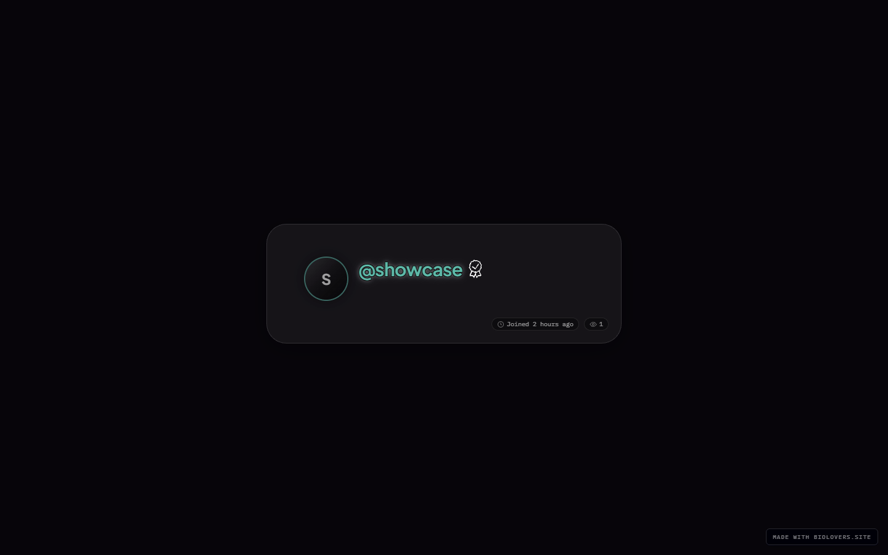

<Note>
Page on the dashboard: <a href="https://dashboard.biolovers.site/dashboard/edit/profile/corner" target="_blank" rel="noopener">dashboard.biolovers.site/dashboard/edit/profile/corner</a>
</Note>

This is the **small icon row** that sits on / under your profile card. Stats like profile views, joined, location, and timezone live here.

On [Your details → Location & stats](https://dashboard.biolovers.site/dashboard/edit/profile/corner), use **Stats & location** to choose what appears, **Layout & tooltips** to arrange it, or **Comments** to manage the public comment button. Switching tabs keeps your edits.

<Frame caption="Stats and location stay together, with layout and comments in separate tabs.">
  
</Frame>

## What stats are available

| Stat | What it shows | Notes |
|------|---------------|-------|
| **Profile views** | All-time view count. | Same number as the Overview tile. **Premium** to hide it. |
| **Joined** | A relative age like "3 weeks ago" / "1 year ago". | Display is approximate; we don't expose the exact date / time to visitors. |
| **Location** | Country / region you typed below. | Free text. |
| **Timezone** | Free-text timezone label (e.g. `Europe/Berlin`, `EST`, `GMT+2`). | Static text — does not show a live clock. |
| **User id (UID)** | Your numeric account ID, also called **Registration #**. | Always shown in the @handle tooltip; **Premium** controls whether it appears as a dedicated meta pill. |

Each stat has a checkbox to **show / hide** it. The Profile views and User id checkboxes are **locked on** for free accounts (Premium can hide them).

## Positions

Open **Layout & tooltips**. Use each stat's position dropdown to choose a corner of the card or screen, or hide it from the stats line. Multiple stats can share a position; use **Stat order** to arrange them.

### Same stats, different placements

<Frame caption="Default — site default placement.">
  
</Frame>
<Frame caption="All stats forced into the card top-left corner.">
  
</Frame>
<Frame caption="All stats forced into the card bottom-right corner.">
  
</Frame>

## Hover tooltip style

Hover any stat icon and a small tooltip appears. Two looks:

- **Styled** — opaque background with the card's tint.
- **Transparent** — plain text without a tooltip panel.

## Meta line color *(Premium)*

A separate color picker lets Premium accounts override the meta-line color independently of the rest of the card.

## Profile comments *(Premium)*

Open **Comments** in the [Location & stats panel](https://dashboard.biolovers.site/dashboard/edit/profile/corner) to turn the public comment button on or off and choose its corner.

- **Show comments on my profile** — shows the chat bubble and lets logged-in visitors post.
- **Comment button position** — **Top left**, **Top right**, **Bottom left**, or **Bottom right**. Default is **Top right**.

On free accounts this section is greyed out with an upgrade nudge. Full details — limits, deleting, who can post — are on [Profile comments](/public-profile/comments).

## Tips

- The stats row gets crowded fast. Three pills usually look best.
- If you turn off **all** the optional stats and Premium-hide the locked ones, the row disappears entirely.

## Common questions

<AccordionGroup>
  <Accordion title="My UID looks weird, is something wrong?">
    UIDs are just sequential numbers — early accounts have small numbers, newer ones bigger. Nothing personal in there.
  </Accordion>
  <Accordion title="Why doesn't 'joined' show the exact date?">
    By design — visitors only see a relative age ("3 weeks ago"). The full date isn't exposed.
  </Accordion>
  <Accordion title="Can I show a country flag instead of text?">
    Yes — type the country emoji into the **Location** field. They render as a flag on most devices.
  </Accordion>
  <Accordion title="My timezone doesn't show a live clock">
    The timezone field is a free-text label, not a live clock. If you want "current time", put it in your bio or a markdown widget — the meta pill just shows the label you typed.
  </Accordion>
  <Accordion title="Can I drag the stats to reorder them?">
    Open **Layout & tooltips**. Pick a position for each stat, then use **Stat order** to arrange stats that share a position.
  </Accordion>
</AccordionGroup>
