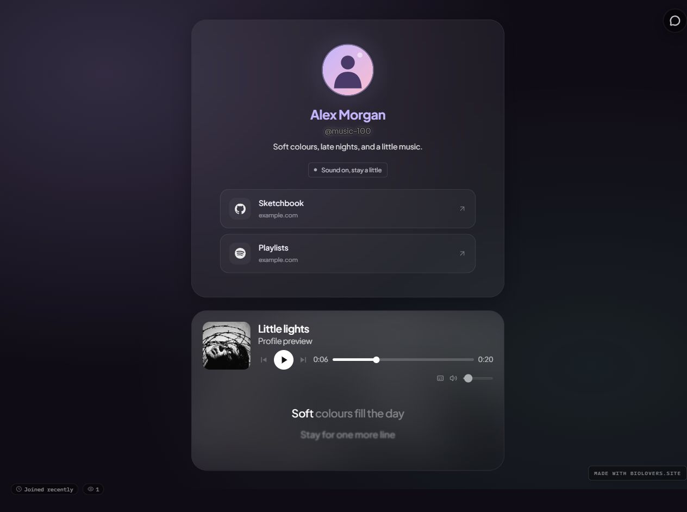

Profiles with [background music](/media/background-music) can show a player inside the profile, below it, or at the bottom of the screen. The owner chooses its placement in [Music → Player style](https://dashboard.biolovers.site/dashboard/edit/media/audio).

## Artwork cards and the bottom bar

**Inside profile frame** and **Below profile frame** use a rounded music card with larger album artwork, song details, and controls. **Bottom of screen** keeps the compact bar pinned to the screen. On small screens, controls and the seek row wrap to fit.

<Frame caption="Example artwork music card beneath a profile. Lyrics stay below its controls.">
  
</Frame>

## Controls

| Control | What it does |
| --- | --- |
| **Play / Pause** | Start or stop the current song. |
| **Previous / Next** | Change tracks when the profile has more than one. |
| **Seek bar** | Move to another point in the song. Keyboard controls are supported. |
| **Volume** | Change playback volume. |
| **Mute** | Silence or restore sound. |
| **Lyrics** | Hide or show the lyric panel when the owner enabled lyrics for that track. |

Pause, mute, and volume choices are remembered in the visitor's browser. A paused song stays paused on a later visit until the visitor chooses Play.

## Lyrics

Premium owners can enable **Glass**, **Karaoke**, or **Minimal** lyrics. The words stay below the controls in every placement.

- Line timestamps follow a line at a time.
- Supplied word or syllable timestamps allow more precise highlights.
- Plain embedded lyrics display readable text without syncing.
- Before the first timestamp, upcoming text is dimmed.

Changing style does not create missing word timing. See [Lyrics and LRC files](/media/lyrics) to add or correct lyrics.

## Hidden player and video audio

An owner can choose **Hide bar (playback continues)**. If playback is blocked or a visitor has a remembered pause or mute, controls can appear so they can restore sound.

When the owner uses audio from the page's background video, the controls operate that video audio. Uploaded-track lyrics and playlist controls do not apply to that source.

If the player is silent, check Play, Mute, and Volume first. See [Audio won't autoplay](/troubleshooting/audio-autoplay) for browser-related issues.

## Owner preview

The saved dashboard preview shows the actual music-player layout and lyric style with playback controls disabled. In [Music & lyrics](https://dashboard.biolovers.site/dashboard/edit/media/audio), **Preview player on profile** opens directly at the player. It defaults to a 390 px Phone view and follows your saved changes.

Sound is off in preview. Open your public page to test playback, seeking, and lyric timing.
